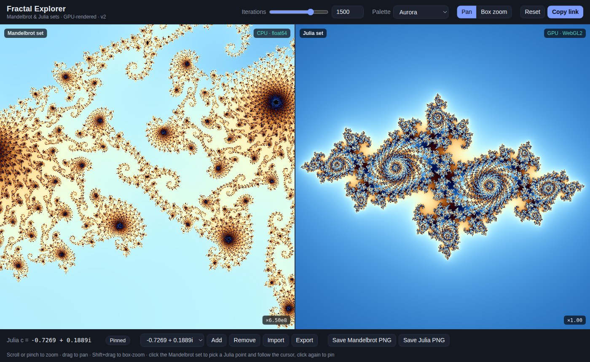
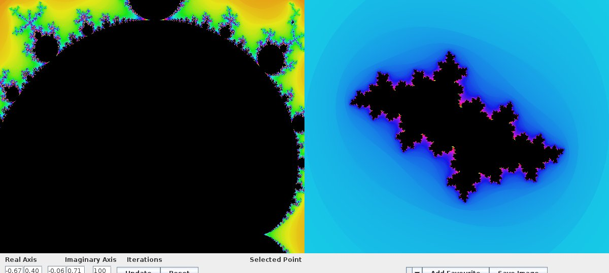

# Mandelbrot Viewer

An explorer for the Mandelbrot set and its Julia sets. It began as a Java Swing university project in 2014 and was rewritten in 2026 as a GPU-accelerated web app.

**Live demo: https://domsmith94.github.io/mandelbrotviewer/**

| | Directory | Stack | Status |
|---|---|---|---|
| **v2** | [`web/`](web) | TypeScript, WebGL2, Web Workers, Vite | Maintained, deployed to GitHub Pages |
| **v1** | [`java/`](java) | Java, Swing | Original 2014 code, kept for reference |



<details>
<summary>The 2014 Java version</summary>


</details>

## What changed in v2
- **GPU rendering:** WebGL2 shaders draw both sets in real time at Retina resolution. The Java version rendered single-threaded on the UI thread at about 5 fps.
- **Deep zoom:** beyond float32 precision the app switches automatically to float64 on a pool of Web Workers, down to a view width of about 1e-13.
- **Shareable:** the full view is stored in the URL. It works on desktop and touch devices, with scroll/pinch zoom, pan and box zoom.
- **Correctness:** the 2014 bugs in smooth colouring, recursion depth, degenerate zoom and malformed favourites are fixed. Tests check the TypeScript maths against output generated by the original Java `Calculator`, and CI recompiles the Java code to keep that fixture honest.

See [`web/README.md`](web/README.md) for features and development, and [`java/README.md`](java/README.md) for running the original.

## Repository layout
```
web/                 TypeScript + WebGL2 app (v2)
java/                Original Java Swing app (v1)
docs/                Screenshots
.github/workflows/   CI (lint, tests, build, Java parity) and GitHub Pages deploy
```
